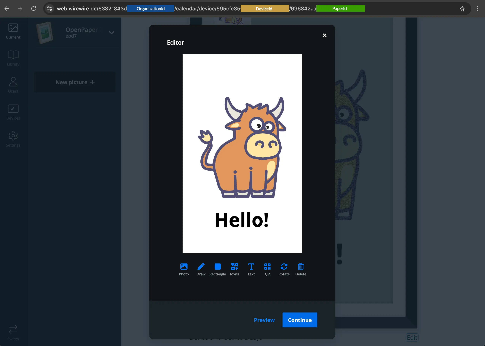
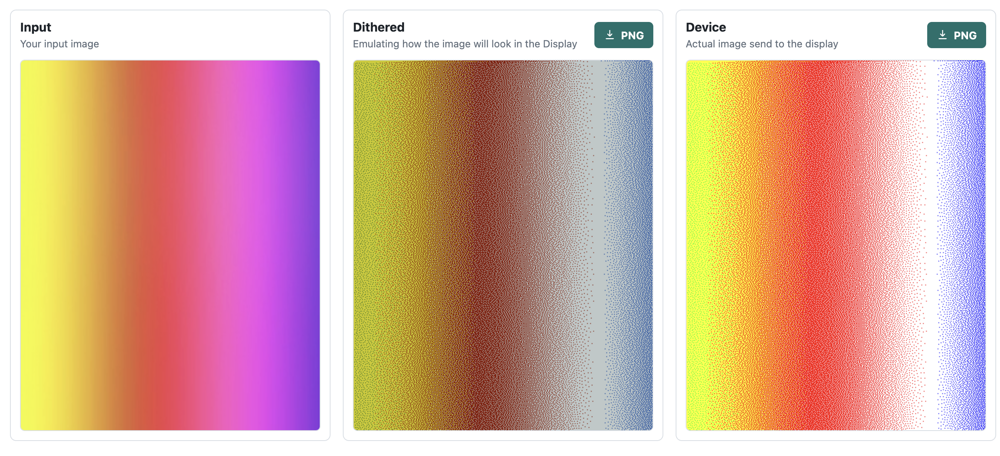

Use this endpoint when a paper already exists and you want to replace its image.

This guide focuses on the practical upload flow for `POST /papers/uploadSingleImage/{paperId}`. For the generated endpoint reference, see [API Reference: Upload single image](/api-reference/papers/uploadsingleimage/paperid/post).

For an Open Integration that receives external events, see [Webhooks & content push](/open-integration/webhooks). That flow sends text or images to a saved integration paper, uses its render page for layout, and reports delivery status through authenticated callbacks.

## Getting the parameters right

You need a paperID, which is best obtained by the web application when viewing the details of an existing paper.



Make sure to use the correct part of the URL as the paper ID.

## What this endpoint does

For image and printer papers, this endpoint replaces the existing image. It does not add images to a gallery.

Send the request as `multipart/form-data`.

## Authentication

Use the API key flow described in [Authentication](/api-guide/authentication) and send your key in the `x-api-key` header:

- `x-api-key: <your-api-key>`

## Request fields

Send at least one file: `picture` or `pictureDevice`.

- `picture`: Source image file.
- `pictureDevice`: Supported public API field for a device-ready PNG or JPEG file, up to 10 MiB (10,485,760 bytes).
- `pictureEditable`: Optional JSON string with editor data.
- `settings`: Optional JSON string merged into `paper.meta` before the image is processed.
- `forceUpload`: Send the text value `true` to bypass the similarity check, including for `pictureDevice`.

## How the upload behaves

### Upload only the source image

If you send only `picture`, the backend treats it as the source image, prepares it for the device, and updates the paper image.

<Callout type="info" title="Preferred flow">
  Use this flow when your application does not perform its own image processing.
</Callout>

### Upload the source image and a device-ready image

If you send both `picture` and `pictureDevice`:

- `pictureDevice` is used as the final image sent to the device.
- `picture` supplies the original reference, app preview, and thumbnail.

You can also send only `pictureDevice`. In that case the preview and thumbnail are generated from that file. Uploading an image does not rebuild any existing editable canvas.

<Callout type="info" title="Advanced flow">
  Use this flow when your application already performs its own resizing,
  conversion, or dithering.
</Callout>



### Prepare a device-ready image

`pictureDevice` is passed through unchanged: no resizing, rotation, dithering, or re-encoding. Send it as a **file**, not `pictureDevice=true`.

Always use the native panel dimensions, including when the frame hangs in portrait:

| Device kind | File size in pixels | Our renderer's portrait rotation | Our renderer's landscape rotation |
| --- | --- | --- | --- |
| `epd7` (Paper 7) | 800 × 480 | 90° clockwise | 180° |
| `openpaper13` (Paper 13) | 1600 × 1200 | 90° clockwise | None |

For example, rotate a 480 × 800 portrait image 90° clockwise to produce the 800 × 480 file for Paper 7. Apply the rotation to the pixels before uploading; EXIF orientation values other than 1 are rejected. These rotations describe our renderer's convention. The backend does not adjust `pictureDevice` using the orientation setting or sensor. Sensor compensation and upside-down mounting are outside this upload contract.

PNG is recommended for pre-dithered images because JPEG compression changes pixel colors. Use an opaque, 8-bit RGB or RGBA PNG. Our Spectra 6 renderer writes these six device colors: black `#000000`, white `#FFFFFF`, red `#FF0000`, green `#00FF00`, blue `#0000FF`, and yellow `#FFFF00`. The API does not validate or remap palette values; other colors pass through, and their panel appearance is not guaranteed. A `.jpg` storage key alone does not mean the device image was converted to JPEG.

### Similarity and upload status

The similarity check uses the device-ready image, against the last successfully uploaded image for that device. It does not compare the original `picture` or confirm what the panel currently displays. If a previous image failed to display, uploading it again may still be skipped. Use `forceUpload=true` to retry it.

The response includes `similarityPercentage` (or `null` when unavailable/bypassed), `skippedUpload`, `uploadAttemptId`, and `reason`. `uploadFailed` indicates a server-side upload failure and is omitted for skipped uploads. Previews are updated even when the device transfer is skipped.

**HTTP 200 is not a display confirmation.** The frame downloads the image separately, usually on its next wake-up.

### Validation errors

For `pictureDevice`, the API checks the actual image contents, not just the filename or MIME type:

- **400:** unsupported format, unreadable or incomplete image, wrong panel dimensions, EXIF rotation, or invalid multipart fields. BMP, HEIC/HEIF, and raw pixel buffers are not accepted.
- **413:** the file exceeds 10 MiB. This limit applies specifically to `pictureDevice`.

Errors contain `code` and a readable `message`, for example:

```json
{
  "code": 400,
  "message": "pictureDevice must be 800x480 pixels for epd7, in native panel orientation.",
  "raw": null
}
```

### Update paper settings during the upload

If you send `settings`, the backend merges those values into `paper.meta` before handling the image. The `orientation` setting affects source-image processing; it does not rotate a supplied `pictureDevice` file.

## Example: simple upload

```bash
curl -X POST "https://api.paperlesspaper.de/v1/papers/uploadSingleImage/<paper-id>" \
  -H "x-api-key: <your-api-key>" \
  -F "picture=@/path/to/image.png"
```

This flow typically:

- uploads the image,
- prepares it for the device, and
- updates the paper's image timestamp.

## Example: upload with a device-ready image

```bash
curl -X POST "https://api.paperlesspaper.de/v1/papers/uploadSingleImage/<paper-id>" \
  -H "x-api-key: <your-api-key>" \
  -F "picture=@/path/to/original.png" \
  -F "pictureDevice=@/path/to/device-ready.png;type=image/png" \
  -F "forceUpload=true"
```

## Example: upload with settings

```bash
curl -X POST "https://api.paperlesspaper.de/v1/papers/uploadSingleImage/<paper-id>" \
  -H "x-api-key: <your-api-key>" \
  -F "picture=@/path/to/image.png" \
  -F 'settings={"lut":"default","orientation":"portrait"}'
```

This behaves like a metadata update followed by the image upload in one request.

## Frontend example

```ts
const formData = new FormData();

formData.append("picture", originalFile);

if (deviceReadyFile) {
  formData.append("pictureDevice", deviceReadyFile);
}

if (editableJson) {
  formData.append("pictureEditable", JSON.stringify(editableJson));
}

if (settings) {
  formData.append("settings", JSON.stringify(settings));
}

await uploadSingleImage({
  id: paperId,
  body: formData,
  deviceId,
});
```

## Common mistakes

- Sending JSON instead of `multipart/form-data`.
- Setting the `Content-Type` header manually when using `FormData`.
- Forgetting to `JSON.stringify(...)` in the `settings` payloads.
