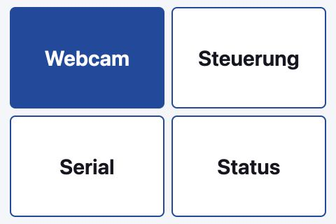

The OpenPaper testbench lets you inspect the physical display, capture firmware logs, and control the frame's power from a Raspberry Pi or a remote browser. It runs as a Balena application and exposes the same operations through an HTTP API for automated tests.

This guide describes the setup verified with **testbench 1.3.4 on 30 October 2026**. The application source is in `tools/openpaper-testbench` in the `paperlesspaper-web` repository. Its API is separate from the paperlesspaper cloud API documented elsewhere on this site.

## Hardware and connections

| Part | Tested configuration |
| --- | --- |
| Host | Raspberry Pi 3 Model B, Balena device type `raspberrypi3-64` |
| Power supply | Stable 5 V / 2.5 A supply and a short Micro-USB cable |
| Touch display | 480 × 320 SPI display, ILI9486-compatible `piscreen` profile and ADS7846 touch |
| Webcam | UVC HD USB Camera, USB ID `32e4:9230`, 1280 × 720 capture |
| Power relay | LCUS-1 / CH340 USB serial relay, USB ID `1a86:7523`, 9600 baud |
| Frame serial | Separate CP210x USB-to-UART connection, USB ID `10c4:ea60`, 115200 baud, 8N1 |
| Storage and network | microSD card, Wi-Fi or Ethernet |

Mount the webcam so the entire e-paper panel is visible and its position cannot change during a comparison. Keep the lighting stable. Connect the webcam, USB relay, and the frame's **USB data cable** to the Pi; the relay's USB connection does not carry the frame's serial logs.

```text
Raspberry Pi
  ├─ SPI/GPIO ────────────── touch display
  ├─ USB ─────────────────── webcam → view of the OpenPaper display
  ├─ USB ─────────────────── LCUS-1 relay
  │                            COM/NC → frame power circuit
  └─ USB data cable ──────── OpenPaper CP210x → firmware UART logs
```

The tested relay uses **COM and NC (normally closed)** in the frame's low-voltage power circuit. With the relay de-energized, that circuit is closed. Disconnect power before changing wiring, and check the actual cable and board connections before adapting another frame. A battery or another USB supply may keep the frame powered even when this circuit is open.

The software identifies the relay and UART by their distinct USB IDs. Do not rely on `/dev/ttyUSB0` and `/dev/ttyUSB1` staying in the same order after reconnecting. When multiple matching adapters are present, set `RELAY_DEVICE` and `SERIAL_DEVICE` explicitly; the application still checks the USB device type.

<Callout type="warn" title="Power switching is not a button press">
  The installed USB relay interrupts the frame's power circuit. It does not short
  the rear button contacts. A sent power pulse is not proof of a reboot or factory
  reset: confirm the outcome through fresh serial output and the display.
</Callout>

## Install with Balena

1. Create a Balena fleet for `raspberrypi3-64`, add a device, and download a provisioned balenaOS image with your network settings.
2. Flash the image to the Pi's microSD card. This replaces its contents. Connect the peripherals and power supply, then wait for the device to appear online.
3. From the root of the application repository, deploy only the testbench directory:

   ```sh
   balena push <organization>/<fleet> --source tools/openpaper-testbench
   ```

4. Configure the display and authentication below. Wait for all services to be running, then open `http://<pi-address>:8080` from a trusted LAN.
5. Verify a fresh camera image, serial output, touch alignment, and relay operation before relying on automated tests.

The application has three services:

| Service | Purpose |
| --- | --- |
| `testbench` | FastAPI on port 8080; owns the camera, relay, optional GPIO, and serial reader |
| `kiosk` | Xorg, Matchbox, and Chromium; opens the simplified touch UI locally |
| `gateway` | nginx on port 80; forwards the Balena public device URL to the protected API |

Photos, the comparison reference, and saved camera settings live in the persistent `captures` volume. The application retains the newest 200 photos by default (`MAX_PHOTOS`). Serial logs are a bounded in-memory buffer and do not survive a service restart.

### Display configuration

The display's exact retail model is unknown. These settings were verified on the installed panel; a blue PCB alone does not identify a compatible controller.

Set the Balena host configuration variable `RESIN_HOST_CONFIG_dtoverlay` to:

```text
"vc4-kms-v3d,cma-320","piscreen,speed=16000000,rotate=270,fps=15"
```

Set these variables for the `kiosk` service:

```text
FRAMEBUFFER=auto
TOUCH_DEVICE=ADS7846 Touchscreen
TOUCH_MATRIX=1 0 0 0 -1 1 0 0 1
```

The matrix mirrors the touch Y-axis for this orientation. Recalibrate if your panel or rotation differs. The tested display runs at 480 × 320; the kiosk also disables Chromium translation prompts. Do not run Raspberry Pi OS `LCD-show` installation scripts on balenaOS.

### Service configuration

The shipped Compose file enables the relay, leaves GPIO button control disabled, and selects `/dev/video0` for the camera.

| `testbench` variable | Purpose |
| --- | --- |
| `CAMERA_DEVICE` | Video capture device; default `/dev/video0` |
| `CAMERA_WIDTH`, `CAMERA_HEIGHT`, `CAMERA_FPS` | Capture settings; shipped values 1280, 720, and 5 |
| `RELAY_ENABLED` | `1` enables the tested COM/NC relay profile |
| `RELAY_DEVICE`, `SERIAL_DEVICE` | Optional explicit paths when adapter selection is ambiguous |
| `SERIAL_BAUDRATE` | Firmware UART baud rate; default 115200 |
| `BUTTON_ENABLED` | Leave at `0` until an isolated button contact is wired |
| `API_TOKEN` | Separate secret for API clients |
| `WEB_PASSWORD_HASH` | scrypt hash of the browser login password |

Generate a strong API token and a separate browser password. The browser password must be stored as a hash, not as plaintext in Compose. With the application's Python dependencies installed, generate the hash from an interactive password prompt:

```sh
cd tools/openpaper-testbench/api
python -c 'from getpass import getpass; from auth import hash_password; print(hash_password(getpass("Web password: ")))'
```

Put the resulting hash in the `testbench` service's `WEB_PASSWORD_HASH` variable in Balena. Set `API_TOKEN` independently. Keep the original password and token in your password manager. Provisioned images contain device/network configuration and should not be published with the documentation.

## Touch UI and browser dashboard

The Pi opens `/touch.html` automatically. Its home screen contains only four large buttons: **Webcam**, **Steuerung** (control), **Serial**, and **Status**. Each opens a separate detail page with Back at the top left.



The full browser dashboard at `/` adds camera controls, a photo gallery, reference comparison, serial filtering, pause/autoscroll, log downloads, and detailed diagnostics. Both interfaces use the same API.

The large power toggle shows the **last commanded state**, not a measured supply voltage. After startup or a connection failure, the state can be unknown; the first toggle then explicitly sends power on.

### Remote access

Enable the Balena public device URL after configuring the password and API token. Use its **HTTPS** URL. The browser login asks only for a password; automation uses the separate bearer token. No router port forwarding is needed. The Pi and its internet connection must remain on.

Browser sessions last up to 12 hours. Logout or a `testbench` service restart invalidates them. Repeated failed logins are rate limited. Camera images, photos, logs, controls, and the API schema require authentication.

Only the kiosk's local loopback connection bypasses login. The gateway marks public requests with `X-Testbench-Public: 1`, preventing them from using that exception. Keep this marker and Uvicorn's `--no-proxy-headers` configuration intact. Direct LAN access on port 8080 uses HTTP; use the public HTTPS URL when the network is not trusted.

## Camera and image evaluation

Use the live view to align the camera, then capture a photo for a persistent record. To compare the display against an expected image:

1. Wait for the e-paper refresh to finish.
2. Select a crop containing the panel rather than the surrounding room.
3. Save the current image and crop as the reference.
4. Display the image under test, wait for refresh completion, and run the comparison.

The comparison reports mean grayscale difference, changed-pixel fraction, brightness, and a sharpness measure. `matches_reference` uses the mean difference with a default threshold of 0.05. This is a pixel comparison, not OCR or semantic validation. Camera movement, lighting changes, or changed exposure can alter the result. Capture a new reference after changing the resolution or imaging conditions.

### Native settings and night captures

The browser dashboard exposes supported V4L2 controls: brightness, contrast, gain, exposure mode, exposure time, and dynamic frame rate. Settings are read back from the device and persisted. “Ausgangswerte” restores the initially saved valid settings, which are not necessarily the manufacturer's defaults.

The tested webcam reports manual exposure from **0.1 to 500 ms**, in native units of 100 microseconds. Its driver uses `auto_exposure=1` for manual mode and `3` for automatic mode. These ranges and menu values are camera-specific; query the controls endpoint before setting them. The driver-reported maximum does not prove the sensor achieves that duration at every frame rate.

“Nachtprofil” selects maximum reported manual exposure and gain. “Nachtfoto aufnehmen” temporarily applies that profile, waits for the camera to settle, and averages fresh frames over the selected duration. The API accepts 2–60 seconds; the UI offers 5, 10, 30, and 60 seconds. The previous settings are restored after completion or cancellation, with restore errors reported explicitly.

A night capture is **frame averaging**, not a single 60-second sensor exposure. It reduces noise in a static scene; motion can blur and missing light cannot be recovered. The result is saved in the same photo gallery.

## Power pulses and reset sequences

The installed NC relay uses these commands at 9600 baud:

| Frame power command | Relay bytes |
| --- | --- |
| On / contact closed | `A0 01 00 A1` |
| Off / contact open | `A0 01 01 A2` |

The application's reset action sends either one pulse or **six pulses**. Each pulse interrupts power for **250 ms**, with **1500 ms of power on between pulses**. It attempts to leave power on at the end. These timings are fixed in version 1.3.4; the API does not accept custom pulse intervals. The earlier 50 ms / 1 second experiment did not change these defaults.

<Callout type="warn" title="Six pulses may erase configuration">
  The six-pulse sequence can clear Wi-Fi and activation data, depending on the
  firmware and whether the frame actually loses power. It requires explicit
  confirmation in the UI and `confirm_data_loss=true` in the API. A successful
  HTTP response confirms the commands were sent, not that factory reset completed.
</Callout>

In the tested setup, short interruptions did not reliably produce new boot messages; a three-second interruption did. Stored energy or other power paths can affect the outcome. Keep serial capture running and check for a new boot/init message. See the [firmware testbench](https://github.com/paperlesspaper/paperlesspaper-firmware/tree/main/testbench) for the separate firmware-side test tooling.

### Optional rear-button contact

Rear-button control is planned but **not wired in this setup**. `/api/button/press` is independent from `/api/reset` and remains unavailable with `BUTTON_ENABLED=0`.

To add it, connect a suitable isolated PhotoMOS or relay contact across the two switch sides of the rear button. Do not apply Pi GPIO voltage to the frame's button circuit, and do not drive a relay coil directly from a GPIO. Verify the switch contacts and use a 3.3 V-compatible driver with a defined inactive state during boot.

The proposed control pin is BCM26 (physical pin 37), with Pi-side ground on pin 39. Check the actual display's pin use and mechanical clearance before wiring. Only then configure `BUTTON_GPIO`, the correct `GPIO_CHIP`, polarity (`BUTTON_ACTIVE_LOW`), and `BUTTON_ENABLED=1`. Button pulses accept 50–3000 ms and default to 250 ms.

## Serial logs

The CP210x connection is read-only: the testbench does not send UART commands or deliberately toggle DTR/RTS for resets or flashing. It reconnects after USB removal. An open port alone does not prove the frame is producing logs; inspect `last_received` and fresh line timestamps.

The RAM buffer holds up to 2000 lines, each bounded to 2048 bytes, with UTC timestamps and increasing IDs. Download logs before restarting the service. For more background, see [USB Serial](/api-guide/usb-serial).

## HTTP API

Use the testbench's own `/docs` for the interactive endpoint reference and `/openapi.json` for its schema. These routes require authentication; they are unrelated to this website's cloud API reference.

Set the URL of your own testbench and load its bearer token from a private file:

```sh
export TESTBENCH_URL='https://<device-uuid>.balena-devices.com'
read -r TESTBENCH_TOKEN < /path/to/private/api-token.txt

# Read status and capture a photo.
curl --fail-with-body -H "Authorization: Bearer $TESTBENCH_TOKEN" \
  "$TESTBENCH_URL/api/status"
curl --fail-with-body -X POST -H "Authorization: Bearer $TESTBENCH_TOKEN" \
  "$TESTBENCH_URL/api/photos"

# Read recent serial lines.
curl --fail-with-body -H "Authorization: Bearer $TESTBENCH_TOKEN" \
  "$TESTBENCH_URL/api/serial?after=0&limit=200"
```

| Method | Path | Purpose / JSON body |
| --- | --- | --- |
| GET | `/api/status` | Camera, relay, serial, GPIO, and host diagnostics |
| GET | `/api/camera.jpg` | Latest JPEG; 503 if unavailable or stale |
| GET | `/api/stream.mjpg` | MJPEG live stream |
| POST / GET | `/api/photos` | Save a photo / list saved photos |
| GET | `/api/photos/{name}` | Download a saved image |
| POST | `/api/power` | `{"on":true}` or `{"on":false}` |
| POST | `/api/reset` | `{"count":1}` or `{"count":6,"confirm_data_loss":true}` |
| POST | `/api/button/press` | Optional wired GPIO button: `{"duration_ms":250}` |
| GET | `/api/serial` | Cursor-based logs: `?after=0&limit=200` |
| GET | `/api/serial.txt` | Download current log buffer |
| GET | `/api/camera/controls` | Available controls, ranges, and values |
| POST | `/api/camera/controls` | For example `{"values":{"brightness":8,"contrast":36}}` |
| POST | `/api/camera/restore` | Restore saved initial controls |
| POST | `/api/camera/night-profile` | Select the night profile persistently |
| POST / GET | `/api/camera/night` | Start with `{"seconds":10}` / poll progress |
| POST | `/api/camera/night/cancel` | Cancel a running night capture |
| POST | `/api/reference` | Save reference and normalized crop |
| POST | `/api/analyze` | Compare with reference: `{"max_difference":0.05}` |

`/api/serial` returns `session`, `lines` (`id`, `at`, `text`), `next_cursor`, `truncated`, and `status`. Use `next_cursor` as the next `after` value. Reset the cursor to zero if `session` changes; `truncated=true` indicates a buffer gap. The maximum `limit` is 2000.

For example, save a reference crop and start an asynchronous night capture:

```sh
curl --fail-with-body -X POST -H "Authorization: Bearer $TESTBENCH_TOKEN" \
  -H 'Content-Type: application/json' \
  -d '{"region":{"x":0.15,"y":0.1,"width":0.7,"height":0.8}}' \
  "$TESTBENCH_URL/api/reference"

curl --fail-with-body -X POST -H "Authorization: Bearer $TESTBENCH_TOKEN" \
  -H 'Content-Type: application/json' -d '{"seconds":10}' \
  "$TESTBENCH_URL/api/camera/night"
curl --fail-with-body -H "Authorization: Bearer $TESTBENCH_TOKEN" \
  "$TESTBENCH_URL/api/camera/night"
```

Night capture starts with HTTP 202. Poll until it finishes and inspect the reported result or error; `result.url` identifies the saved photo. Avoid concurrent camera-setting changes during capture. Overlapping relay actions return HTTP 409. A command response alone is not a hardware test assertion.

## Troubleshooting and development

| Symptom | Check |
| --- | --- |
| Undervoltage, camera drops, or unstable USB | Use the dedicated Pi supply; the laptop USB supply caused undervoltage in this setup. |
| Serial device missing | Use a data cable, verify the CP210x device is present, and check the frame's power paths. |
| Relay clicks but the frame does not reboot | Inspect other power sources and fresh UART logs; a short open contact may not remove power long enough. |
| Touch is mirrored or offset | Verify panel rotation, ADS7846 input selection, and the calibration matrix. |
| Camera comparison fails unexpectedly | Wait for refresh, check crop/lighting/focus, and refresh the reference after camera changes. |
| Remote login expires | Log in again; sessions also end when the service restarts. |
| Relay state says unknown | The relay has no electrical feedback; inspect the connection and explicitly choose the desired state. |

For local application development, install `api/requirements.txt`, `pytest`, and `httpx` into a Python 3.11 virtual environment, then run the tests from `tools/openpaper-testbench`:

```sh
python -m pytest -q tests
cd api
DEMO_MODE=1 BUTTON_ENABLED=1 RELAY_ENABLED=0 DATA_DIR=/tmp/openpaper-demo \
  uvicorn app:app --host 127.0.0.1 --port 8097 --no-proxy-headers
```

Demo mode generates synthetic camera images and simulates the GPIO button. Keep `RELAY_ENABLED=0` for local demo work; never enable demo mode in the hardware fleet. Run one API worker so only one process owns the hardware. After changing the touch UI, bump `com.paperlesspaper.ui-version` in Compose so Balena recreates the kiosk and Chromium loads the new interface.
